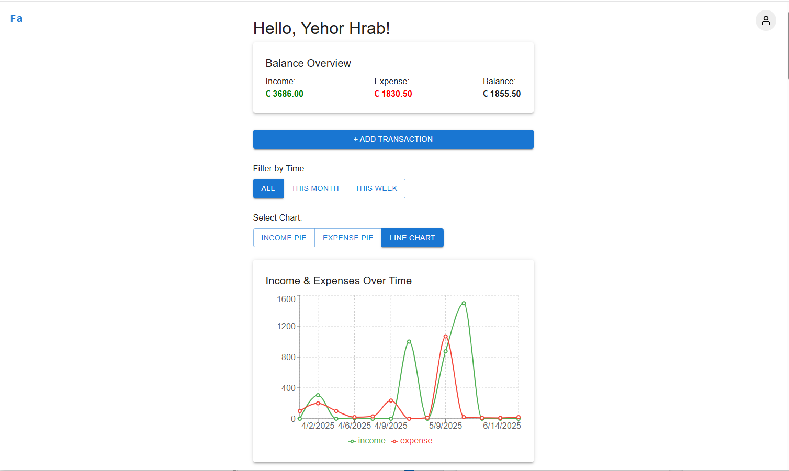
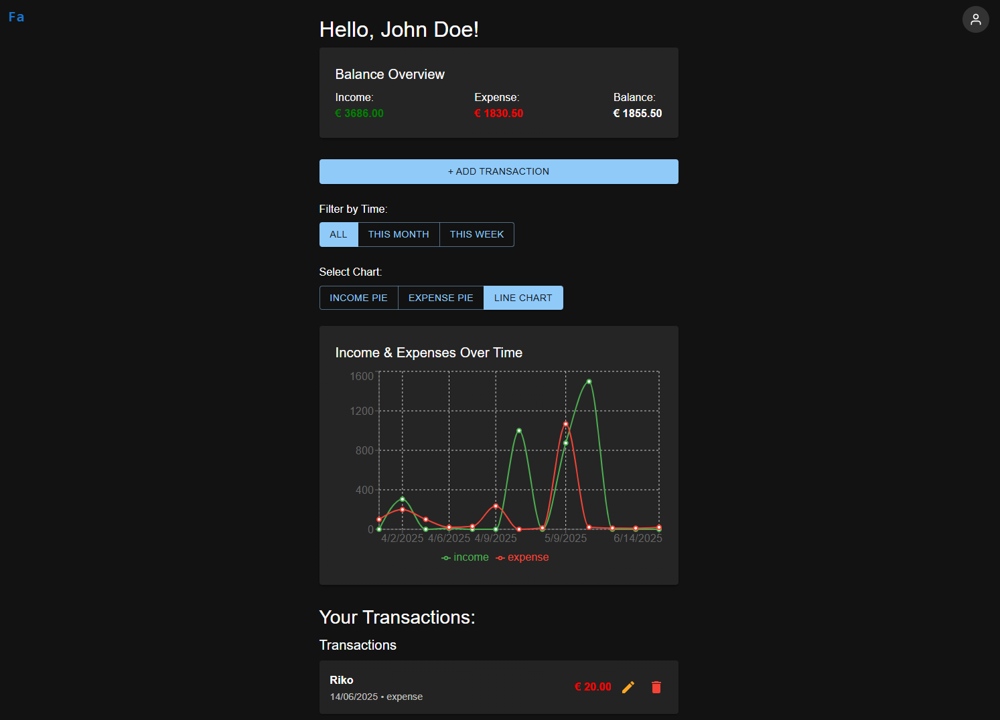
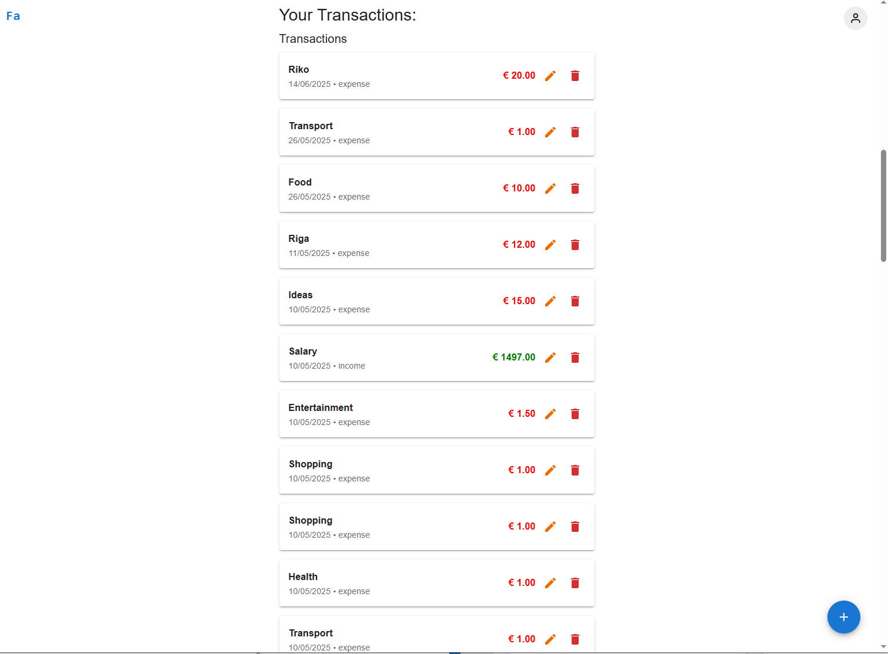
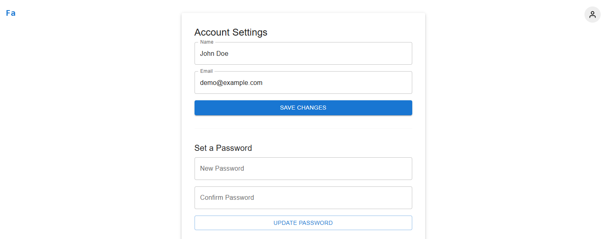
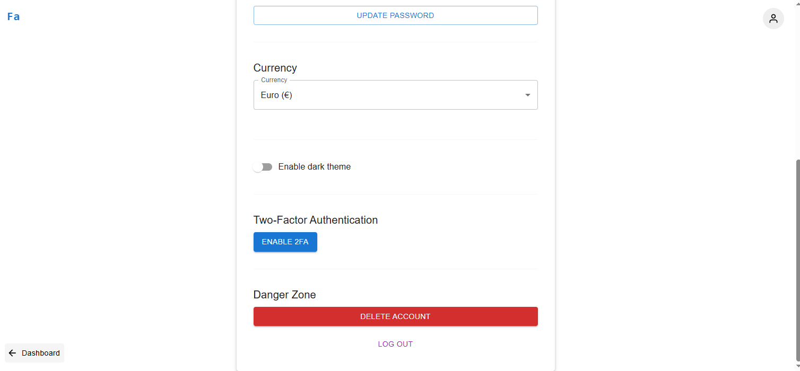
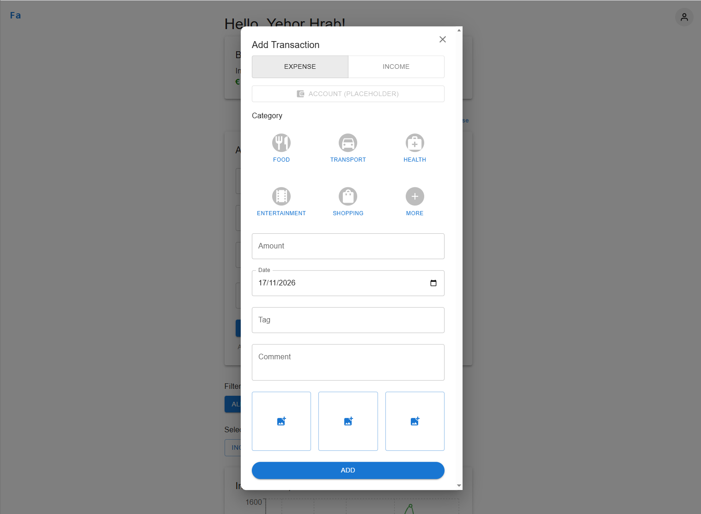
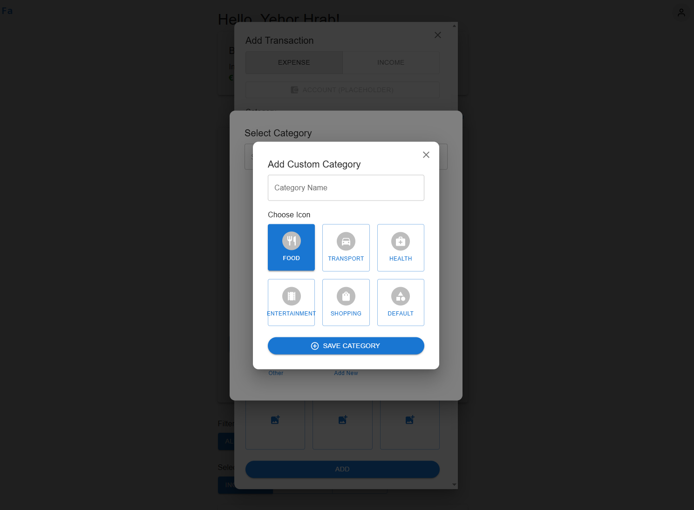
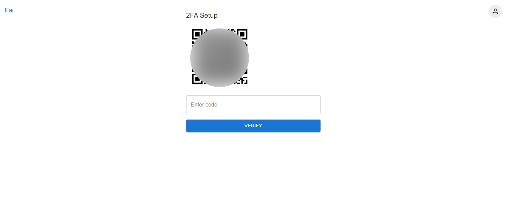

# Finance App

A personal finance tracker built as my Bachelor thesis on **cybersecurity and usability in financial applications** (Riga Technical University, 2025). The goal was to show that strong security (JWT, bcrypt, TOTP two-factor authentication) can be added to a finance app without making it harder to use.

| | |
|---|---|
|  |  |
|  |  | 
|  | |

<details>
<summary>More screenshots</summary>





</details>

## Live demo
[Launch Finance App](https://finance-app-client-usqr.onrender.com)

> Hosted on free tiers: if the server is asleep, the first load can take 1-2 minutes.

Demo account (fictional data): `demo@example.com` / `useOnlySecurePass007!`. You can also register your own account or sign in with Google.

## Features
**Finance**
- Add, edit, delete and filter transactions by category, date and type
- Pie and line charts, multi-currency (EUR, USD, UAH), saved custom categories
- Dark mode and a floating quick-add button

**Security**
- Email/password and Google OAuth 2.0 login, JWT sessions, bcrypt password hashing
- Optional two-factor authentication (TOTP) with any authenticator app such as Google Authenticator, which users can enable or disable in the settings
- Helmet, CORS and rate limiting on the API

## Tech stack
- **Frontend:** React 19, TypeScript, Material UI, Bootstrap, React Router v7, Recharts, Context API
- **Backend:** Node.js, Express, MongoDB with Mongoose, JWT, bcrypt, speakeasy (TOTP), Helmet, dotenv

## Research results (thesis)
- **User survey:** 15 participants in the written thesis (10 men, 5 women, aged 19-42), extended to 50 for the thesis defense. Among the first 15, 72% were willing to take extra steps for stronger security, yet 60% felt security mechanisms make apps harder to use. The comments pointed to missing explanations rather than extra clicks.
- **Load test (Postman):** average latency 120 ms with 1 virtual user and 410 ms with 100 (95th percentile: 490 ms).
- **Security tests (manual, Postman):** requests without or with expired/corrupted JWT, XSS payloads in forms, and access to another user's data were rejected as expected (401/403).
- **Limitations:** small sample, no participants over 50.

## Running locally
1. Clone and install:
   ```bash
   git clone https://github.com/YehorH000/finance-app.git
   cd finance-app/server && npm install
   cd ../client && npm install
   ```
2. Copy `.env.example` to `.env` in `server/` and `client/` and fill in the values.
3. Run `npm run dev` in `server/` and `npm start` in `client/`. The app runs at http://localhost:3000.

## Project structure
`client/` React frontend, `server/` Express API, `docs/` screenshots.

## Work in progress
- Short explanations and a countdown timer in the 2FA setup (the main takeaway of the survey)
- Consistent date formats, multi-account support, image attachments
- Automated tests and CI

## License
Part of a Bachelor thesis, open for learning and inspiration.
